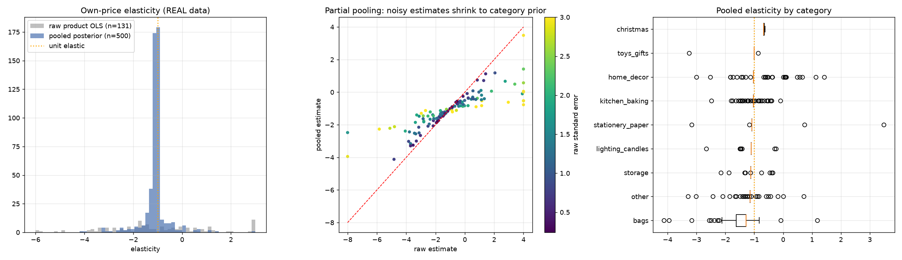
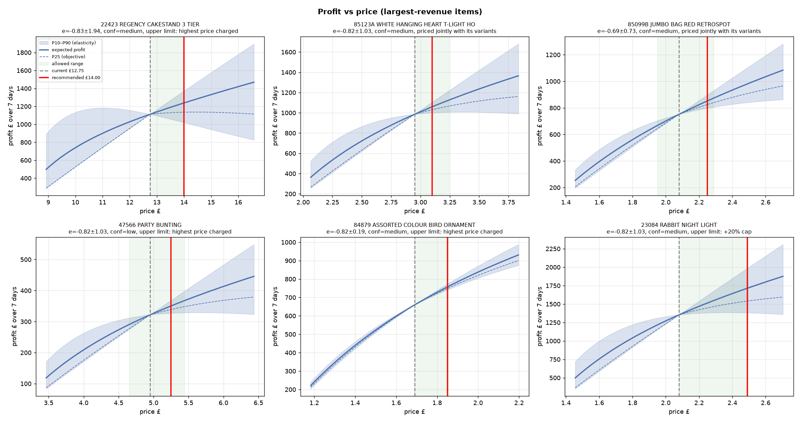

# Retail Pricing AI: Profit-Maximising Price Recommendations from Transactional Sales Data

**Project Report**
**Date:** 14 November 2026
**Repository:** https://github.com/harshithsakhamuri/RetailPricingAI
**Live application:** https://harshithsakhamuri.github.io/RetailPricingAI/

---

## Abstract

This project builds an end-to-end decision system that recommends profit-maximising retail prices. It uses the
UCI Online Retail dataset (about 540,000 transactions, December 2010 to December 2011). The system has three stages:
(1) a machine-learning forecast of baseline demand for the top 500 products, (2) estimates of each product's
own-price elasticity from a two-way fixed-effects panel regression, partially pooled with empirical Bayes, and
(3) a robust optimiser that picks the price maximising the 25th-percentile profit over 500 elasticity draws,
within business constraints. Across the 50 highest-revenue products, the recommended prices raise expected
profit over the 7-day decision horizon from £22,071 to £23,165 (+£1,094, +5.0%). 31 of the 50
recommendations are rated high confidence. Unit costs are assumed and competitor prices are simulated, so the
absolute profit figures are illustrative. The results are delivered through a static web application hosted on
GitHub Pages and an optional Streamlit app.

---

## 1. Introduction

### 1.1 Background
Pricing is one of the strongest levers on retail profit. A small price change can move margin a lot, but only if
customers' price sensitivity is understood. Many retailers set prices with cost-plus rules or by intuition, which
ignores how demand responds to price.

### 1.2 Problem statement
For each product, given its sales history, recommend the price for the coming week that maximises

> **profit = (price − unit cost) × expected units sold**

The recommendation must stay within realistic business rules and come with an honest measure of confidence.

### 1.3 Objectives
1. Forecast baseline weekly demand for each product at its current price.
2. Estimate how demand responds to price (own-price elasticity) from real data.
3. Find the profit-maximising price under uncertainty and business constraints.
4. Report the confidence of each recommendation and the profit at risk.
5. Deliver the results through an easy, no-install web interface.

---

## 2. Data

### 2.1 Source
**UCI Online Retail** dataset (CC BY 4.0): all transactions of a UK-based online gift retailer from
1 December 2010 to 9 December 2011. Fields include invoice number, stock code, description, quantity, invoice
date, unit price, customer ID and country. The raw file (22 MB) is not stored in the repository; see
`data/README.md` for download instructions.

### 2.2 Cleaning
- Removed cancellations (invoices starting with "C"), non-positive quantities and prices, and non-product codes
  (postage, fees, adjustments).
- Limited the analysis to the **500 products with the highest training-period revenue**.
- Reindexed each product to a full daily calendar so that days with no sales count as zero demand.
- Capped extreme demand at each product's 99.5% quantile, computed on training data only.

### 2.3 Product categories
Products were grouped into categories (bags, kitchen/baking, home décor, lighting/candles, Christmas, storage,
stationery/paper, toys/gifts, other) with keyword rules on the description. Categories are used to pool
elasticity estimates.

### 2.4 Data splits (strictly by date)

| Split | Period |
|---|---|
| Train | up to 2011-08-31 |
| Validation | 2011-09-01 to 2011-10-31 |
| Test | 2011-11-01 to 2011-12-09 |
| Decision horizon | 2011-12-10 to 2011-12-16 (7 days after the data ends) |

---

## 3. Methodology

The pipeline is implemented in `src/pricing_profit_optimizer.py`.

### 3.1 Baseline demand forecasting
- **Models:** LightGBM, XGBoost and Random Forest (Tweedie loss where supported), plus a simple ensemble, compared
  against two naive baselines (same day last week; 28-day mean rate).
- **Features:** calendar features known in advance, and lag/rolling demand features that are at least 7 days old,
  so the 7-day-ahead forecast never uses future information. **No price features are used**, so all price effects
  come from the elasticity stage and are not double-counted.
- **Scaling:** targets are scaled by each product's recent selling rate. A level-calibration factor fitted on
  validation (1.252 for XGBoost) corrects the Q4 seasonal growth that tree models cannot extrapolate.
- **Selection:** the model with the lowest validation 7-day WAPE (weighted absolute percentage error on weekly
  product totals) is chosen and refitted on all data.

### 3.2 Own-price elasticity
- For each category, a **daily two-way fixed-effects log-log panel regression** of units on price, with item
  effects and date effects. Elasticity is identified only from within-item price changes, compared with other
  items on the same day, which removes product-level and seasonal confounding.
- Item-level slopes use Newey-West (HAC) standard errors; category slopes use item-clustered errors.
- **Empirical-Bayes partial pooling** (DerSimonian-Laird) shrinks noisy estimates in three levels:
  global → category → item. Products with too little price variation use their category prior.

### 3.3 Competitor effect (simulated)
No competitor data exists in the dataset. A seeded synthetic competitor price is generated, with demand
multiplied by `((comp/p)/(comp0/p0))^0.5` (cross-elasticity 0.5). Three scenarios are evaluated: competitor
10% cheaper, the same, and 10% dearer. A real competitor file can be supplied through `COMPETITOR_PATH`.

### 3.4 Unit costs (assumed)
No cost data exists. Unit cost is assumed to be **60% of each product's median training price**. It can be
overridden by category (`COST_RATIO_BY_CATEGORY`) or by product (`COST_OVERRIDES_PRODUCT`).

### 3.5 Robust price optimisation
For each product, candidate prices are evaluated over **500 draws** from the elasticity's posterior
distribution. The chosen price maximises the **P25 profit** (the 25th percentile), which protects against
elasticity uncertainty. Constraints:

- at most ±20% from the current price;
- at most 10% above the highest price ever charged (flagged as untested);
- a minimum margin of 20%, i.e. (price − cost) / price ≥ 0.20;
- realistic price endings (for example .25, .45, .95);
- an optional stock cap.

### 3.6 Confidence rating
Confidence is based on the decision, not just the statistics:

| Rating | Rule |
|---|---|
| High | downside risk (expected profit lost vs keeping the current price) ≤ 2% **and** the change beats the current price in ≥ 80% of draws |
| Medium | downside risk ≤ 5% |
| Low | otherwise |

Prices above the highest ever charged are capped at medium.

---

## 4. Results

### 4.1 Forecast accuracy

| Model | Val WAPE % (7-day) | Test WAPE % (7-day) | Test MAE | Test RMSE | Test Bias % |
|---|---|---|---|---|---|
| LightGBM | 58.28 | 54.24 | 16.52 | 46.63 | −0.38 |
| **XGBoost (selected)** | **58.19** | **52.87** | 16.06 | 46.62 | −6.11 |
| Random Forest | 62.65 | 60.76 | 17.55 | 47.77 | 2.20 |
| Ensemble | 59.23 | 55.58 | 16.64 | 46.84 | −1.31 |
| Naive: same day last week | 70.88 | 61.61 | 20.18 | 66.36 | −0.82 |
| Naive: 28-day mean rate | 59.93 | 51.72 | 16.00 | 46.78 | −8.20 |

XGBoost won on validation. On the test period, however, it is **slightly worse than the 28-day mean-rate
baseline** (52.9% vs 51.7% WAPE, a 2.2% relative gap). Weekly item-level retail demand is very noisy, and the
machine-learning models add little over a well-chosen naive forecast here. This matters less for pricing than it
might seem: a baseline forecast error scales profit equally at every candidate price, so it changes the size of
the expected profit but not which price is optimal.

### 4.2 Elasticity estimates
- 131 of the 500 products had enough real price variation for a product-level estimate; the rest use their
  category prior.
- Global prior: −1.05 (between-product standard deviation 1.19).
- Pooled elasticities: median −1.08, interquartile range [−1.14, −1.02]; **89% of products are elastic**
  (elasticity < −1).
- 27% of raw product-level estimates had the wrong sign (> 0), a sign of price endogeneity and noise; pooling
  pulls these toward the category prior.

| Category | Panel slope | Prior mean | Products with own estimate |
|---|---|---|---|
| Bags | −1.47 | −1.28 | 24 |
| Other | −1.25 | −1.14 | 25 |
| Storage | −1.22 | −1.12 | 9 |
| Lighting & candles | −1.24 | −1.11 | 7 |
| Stationery & paper | −1.17 | −1.08 | 4 |
| Kitchen & baking | −1.02 | −1.03 | 32 |
| Home décor | −0.99 | −1.02 | 27 |
| Toys & gifts | −0.77 | −1.00 | 2 |
| Christmas | −0.62 | −0.68 | 1 |

### 4.3 Pricing recommendations
For the 50 highest-revenue products over the 7-day horizon (competitor price unchanged):

| Metric | Value |
|---|---|
| Expected profit at current prices | £22,071 |
| Expected profit at recommended prices | £23,165 |
| Expected gain | **£1,094 (+5.0%)** |
| Mean price change | +6.2% |
| Confidence: high / medium / low | 31 / 14 / 5 |

Largest expected gains:

| Stock code | Product | Current £ | Recommended £ | Profit change £ | Confidence |
|---|---|---|---|---|---|
| 23284 | Doormat Keep Calm and Come In | 8.25 | 9.85 | +162.42 | low |
| 22423 | Regency Cakestand 3 Tier | 12.75 | 14.65 | +135.10 | high |
| 47566 | Party Bunting | 4.95 | 5.85 | +112.27 | low |
| 20685 | Doormat Red Retrospot | 8.25 | 9.85 | +66.18 | low |
| 22086 | Paper Chain Kit 50's Christmas | 2.95 | 3.10 | +65.67 | medium |
| 22178 | Victorian Glass Hanging T-Light | 1.95 | 2.25 | +65.19 | high |
| 22960 | Jam Making Set with Jars | 4.25 | 5.10 | +57.44 | high |

Three of the four largest gains are rated **low** confidence, because their estimated elasticities are positive
or very uncertain. These should be price-tested before rollout. The high-confidence recommendations (for example
the Regency Cakestand and the Jam Making Set) are the safest to act on.

### 4.4 Competitor scenarios (simulated)

| Scenario | Profit at current prices £ | Profit at optimised prices £ | Mean price change % |
|---|---|---|---|
| Competitor −10% | 20,938 | 21,977 | 6.18 |
| Competitor unchanged | 22,071 | 23,165 | 6.18 |
| Competitor +10% | 23,148 | 24,296 | 6.18 |

With a constant-elasticity demand curve, a competitor price-level shift multiplies demand equally at every price.
It therefore changes profit but **not the optimal price**. This is a property of the model, not an error.

---

## 5. Deployment

| Component | Description |
|---|---|
| Static web app (`docs/`) | Runs fully in the browser, with no server or login. Users pick a product or enter a new one and see the demand forecast, optimal price, expected units, profit, revenue, confidence and profit at risk, plus a what-if price slider. Hosted on GitHub Pages. |
| Streamlit app (`app/`) | Optional local interactive version that reads `outputs/app_artifacts.pkl`. |
| Export script (`src/export_web_data.py`) | Writes model results to `docs/data.js` for the web app. |
| Windows helpers (`scripts/`) | One-click retraining, app launch and webpage opening. |

To reproduce: install `requirements.txt`, place the dataset in `data/`, run
`python src/pricing_profit_optimizer.py` (about 1–2 minutes), then `python src/export_web_data.py`.

---

## 6. Limitations

1. **Price endogeneity.** Historical price changes are not experiments. Wholesale tier pricing, seasonal list-price
   changes and customer mix can bias elasticities. Fixed effects reduce but do not remove this bias.
2. **Limited price variation.** Most products never changed price, so their elasticity comes from the category prior.
3. **Assumed costs.** Unit costs are 60% of the median price, so absolute profit figures are illustrative.
4. **Simulated competitor.** All competitor results are synthetic and should not be acted on.
5. **Forecast accuracy.** The selected model does not beat the best naive baseline on the test period.
6. **Constant-elasticity demand.** This is a local approximation, used only within ±20% of the current price.
7. **Unusual horizon.** The forecast week (10–16 December 2011) is the pre-Christmas peak; results do not carry
   over to ordinary weeks without retraining on fresh data.

---

## 7. Future work

- Run **A/B price tests** to obtain causal elasticity estimates, starting with low-confidence products.
- Replace the assumed costs with **real landed costs** and the simulated competitor with **real competitor prices**.
- Add **cross-price effects** between substitute and complementary products.
- Improve the demand forecast with promotions, stock-outs and external signals, and consider simpler models
  given the strength of the naive baseline.
- Retrain automatically on new sales data and monitor realised profit against predictions.

---

## 8. Conclusion

The project delivers a complete, reproducible pipeline from raw transactions to price recommendations with
calibrated confidence, served through a zero-install web application. On the top 50 products it identifies an
expected profit gain of about 5% over one week, mostly from modest price increases on products whose demand is
less price-sensitive than their margin implies. The main value of the system is its decision framework: robust
optimisation under uncertainty, explicit business constraints and an honest confidence rating. Its numerical
outputs should be validated with real costs, real competitor data and controlled price tests before being used
in production.

---

## References

1. Chen, D. (2015). *Online Retail* [Dataset]. UCI Machine Learning Repository. https://doi.org/10.24432/C5BW33
2. Chen, T., & Guestrin, C. (2016). XGBoost: A scalable tree boosting system. *Proceedings of KDD 2016*.
3. Ke, G., et al. (2017). LightGBM: A highly efficient gradient boosting decision tree. *NeurIPS 2017*.
4. Newey, W. K., & West, K. D. (1987). A simple, positive semi-definite, heteroskedasticity and autocorrelation
   consistent covariance matrix. *Econometrica*, 55(3), 703–708.
5. DerSimonian, R., & Laird, N. (1986). Meta-analysis in clinical trials. *Controlled Clinical Trials*, 7(3), 177–188.
