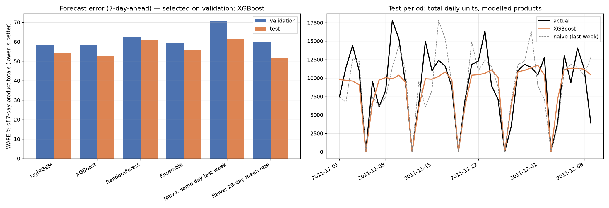

# Retail Pricing AI: Profit-Maximising Price Recommendations from Transactional Sales Data

**Project Report (revised after independent review)**  
**Date:** 14 November 2026  
**Repository:** https://github.com/harshithsakhamuri/RetailPricingAI  
**Live application:** https://harshithsakhamuri.github.io/RetailPricingAI/

---

## Abstract

This project builds an end-to-end decision system that recommends profit-maximising retail prices from the UCI
Online Retail dataset (541,909 transaction lines, December 2010 to December 2011). It has three stages:
(1) a 7-day-ahead forecast of baseline demand for the top 500 products, chosen among machine-learning models and
naive baselines; (2) own-price elasticities whose overall level is measured from the shop's 51 real list-price
changes and whose differences between categories and items come from a Poisson (PPML) fixed-effects panel; and
(3) an optimiser that picks the price with the highest expected profit over 500 elasticity draws within business limits.

This revision follows an independent review. The shop's real price changes show that a 10% rise cut sales by about
22% (elasticity −2.2), far stronger than the uncalibrated daily panel suggested (−0.82). Calibrating to that level
reduced the out-of-sample backtest error from 1.09 to 0.91 (1.41 assuming price has no effect). At this sensitivity
and the assumed 40% margin, current prices are close to optimal: 315 products get a small rise, 124 keep their price
and 61 get a small cut. The expected gain from high- and medium-confidence suggestions is modest, £344 a week across
all 500 products, and only 6 products reach high confidence. The system's main value is a transparent decision
framework and a price-testing plan, not the headline profit figure.

---

## 1. Introduction

### 1.1 Problem statement
For each product, recommend the price for the coming week that maximises

> **profit = (price − unit cost) × expected units sold**

within realistic business rules, and state honestly how far the data supports the recommendation.

### 1.2 Objectives
1. Forecast baseline weekly demand at the current price.
2. Estimate how demand responds to price from real data, and test those estimates.
3. Choose the profit-maximising price under uncertainty and business limits.
4. Report confidence, what set each price, and how to test it.
5. Deliver results through a no-install web interface, with batch and portfolio views.

---

## 2. Data

### 2.1 Source
**UCI Online Retail** (CC BY 4.0): all transactions of a UK online gift wholesaler, 1 December 2010 to
9 December 2011. The raw file (22 MB) is not stored in the repository (see `data/README.md`).

### 2.2 Cleaning
- **Cancellations are netted** against the same customer's earlier orders of the same item, most recent first.
  This removed 250,838 units, and 2,863 order lines were fully cancelled. A further 23,970 cancelled units had no
  earlier order in the data and were ignored.
- **Lines without a CustomerID are excluded** by default (25% of lines, 15% of revenue, mostly guest or retail
  buyers). Recommendations therefore describe registered, mainly wholesale, customers. This is a setting
  (`INCLUDE_GUEST_LINES`).
- Non-product codes (postage, fees, adjustments) and price typos (more than 5× or less than 0.2× the item's
  median) are removed. 393,090 lines remain.
- **One price definition throughout:** the *list price*, the median unit price of regular-size lines (quantity no
  larger than the item's median line). Bulk lines carry tier discounts and would otherwise create artificial price cuts.

### 2.3 Categories and variants
Products are grouped into nine categories by **whole-word** keyword rules on the description, so "TIN" no longer
matches "BUNTING". Colour and design variants (for example the Regency teacups in rose, green and pink) are
identified by removing colour and design words from the name.

### 2.4 Data splits (strictly by date)

| Split | Period | Use |
|---|---|---|
| Train | to 2011-08-31 | fit models |
| Calibration | 2011-09-01 to 2011-09-30 | early stopping, level calibration |
| Selection | 2011-10-01 to 2011-10-31 | choose the forecast model |
| Test | 2011-11-01 to 2011-12-09 | report accuracy; production calibration |
| Decision horizon | 2011-12-10 to 2011-12-16 | recommendations |

The splits are defined relative to the last data day. `--as-of` re-runs the whole system for any earlier week.

---

## 3. Methodology

### 3.1 Baseline demand forecast
- **Candidates:** LightGBM, XGBoost and Random Forest (Tweedie loss), their ensemble, and two naive baselines
  (same day last week; 28-day mean rate).
- **Features:** calendar features and demand lags or rolling windows at least 7 days old; an automated test
  confirms that no feature uses later data. No price features are used, so price effects come only from stage 2.
- **Fair selection:** every candidate, including the naive ones, gets a level-calibration factor fitted on the
  calibration month, and the winner is chosen on the selection month.
- **Production calibration:** the chosen model is refitted on data up to 2011-10-31, and its level error on the
  test weeks (factor 1.20) is applied to the final full-history refit. The factor therefore belongs to the refit
  model rather than the train-only model.

### 3.2 Own-price elasticity
- **Level (event study):** for every real list-price change (the weekly list price moves by at least 2% and holds
  for 2 weeks either side), the item's log change in sales is measured net of the rest of its category. A slope
  through the origin across all 51 events gives the overall elasticity, **−2.21** (s.e. 0.51).
- **Differences (panel):** for each category, a Poisson pseudo-maximum-likelihood regression of daily units on log
  list price with item and date fixed effects, on every trading day (zero-sale days included). Daily prices are
  measured with noise (on days without a regular-size sale the last list price is carried forward), which pulls
  these slopes toward zero by a common factor. All panel slopes are therefore rescaled by **2.69** so their overall
  level matches the event study, and the event study's uncertainty is added to every prior.
- **Item slopes:** an item qualifies only with at least 8 weeks of sales and at least 2 weekly list prices, each held
  for at least 3 **weeks**; item slopes use the category's date effects and Newey-West standard errors.
- **Pooling:** empirical Bayes, global → category → item. A category slope is trusted only if at least 10 of its
  items changed price; otherwise the global prior is used. Items whose own slope shows demand *not* falling with
  price contribute no evidence: they take the category value and are flagged low confidence.
- **Plausible range:** elasticities and their draws are kept between −6 and −0.1. Estimates from just two price
  points can otherwise reach implausible values (one item reached −16.9).
- **Placebo test:** each item's price path is shifted in time 20 times and the category slope re-estimated.
- **Out-of-sample backtest:** everything, including the event-study level, is re-estimated with data up to
  2011-08-31 only, and used to predict the demand change after later real price changes.

### 3.3 Competitor effect (simulated)
A seeded synthetic competitor price is generated. Because the real-data elasticity already contains any competitor
reaction, the competitor enters **only** as a demand shift when its price level differs from the reference
(demand × level^0.5). It does not add to the own-price slope.

### 3.4 Unit costs (assumed)
60% of each item's median list price, adjustable by category or product.

### 3.5 Robust price decision
For each product, candidate prices with realistic endings are evaluated over 500 elasticity draws. The chosen price
has the **highest expected profit**, the same figure users see, so a suggestion is never expected to earn less than
today's price (an automated test enforces this). Risk is reported separately through the confidence rating. Limits:

- at most ±20% from the current price;
- at most 10% above the highest weekly list price ever charged (flagged as untested);
- a minimum margin of 20%;
- an optional stock cap.

Each recommendation also reports:
- **What set the price:** the data (an interior optimum or keeping the price), a named limit, or joint pricing with variants.
- **Lerner check:** the unconstrained optimal price implied by the elasticity, as a plausibility test.
- **Cross-fitted gain:** the price is chosen on half the draws and its gain scored on the other half.
- **Joint pricing:** variants that currently share a price keep one common price.
- **P10–P90 profit range:** includes both elasticity uncertainty and baseline-forecast error (empirical
  actual/forecast ratios from the test weeks, by volume band).

### 3.6 Confidence
| Rating | Rule |
|---|---|
| High | profit at risk vs the current price ≤ 2%, the change beats the current price in ≥ 80% of draws, the price has been charged before, **and the item has its own price-change evidence** |
| Medium | profit at risk ≤ 5% and the change wins in ≥ 60% of draws |
| Low | otherwise, or very low volume, an infeasible price range, or contradictory own data |

### 3.7 Price-test planner
For every item below high confidence, the system designs a switchback test (alternate weeks at the current and test
price) and computes the trading days needed to distinguish elasticity −1 from −2 at 5% significance and 80% power.
It also estimates the duration when the same percentage change is tested across the item's category.

---

## 4. Results

### 4.1 Forecast accuracy (7-day product totals, WAPE %)

| Model | Calibration | Selection month | Test | Test bias % |
|---|---|---|---|---|
| **LightGBM (selected)** | 1.31 | **63.0** | 53.5 | −0.5 |
| XGBoost | 1.24 | 63.6 | 52.5 | −2.1 |
| Random Forest | 1.16 | 67.2 | 59.3 | 0.8 |
| Ensemble | 1.24 | 64.1 | 54.6 | −0.6 |
| Naive: same day last week | 1.12 | 75.4 | 66.5 | 7.9 |
| Naive: 28-day mean rate | 1.11 | 65.8 | 52.9 | −1.4 |

LightGBM wins the selection month fairly, but on the test weeks it is slightly worse than XGBoost and the calibrated
28-day average. **Machine learning adds no reliable accuracy over a calibrated simple average for this data.** The
baseline scales profit equally at every price, so this affects the £ figures but not which price is chosen.

### 4.2 Elasticity

| Evidence | Result |
|---|---|
| Event study, 51 real list-price changes on 50 items | elasticity −2.21 (s.e. 0.51) |
| Daily panel before calibration (median) | −0.82, scaled by 2.69 |
| Pooled elasticity, all 500 items (median) | −2.21; items with their own price changes: median −2.54 |
| Categories with a usable slope | bags, kitchen & baking, home décor, other; the rest use the global prior |

- 63 items have usable price changes of their own, 405 never changed price, and 32 have contradictory data.
- **Placebo test:** the real slopes for bags (z = −3.5), kitchen & baking (−4.9) and home décor (−2.3) lie well
  outside their placebo distributions, so these are genuine price effects. "Other" (z = −1.6) is not clearly
  distinguishable from noise.
- **Backtest:** on 10 later real price changes, the calibrated model's predicted demand change has mean absolute
  error 0.91, against 1.41 for assuming price has no effect and 1.09 for the uncalibrated model (correlation 0.73,
  direction correct in 60%). The events imply a median elasticity of −2.13, in line with the calibrated −2.21.
- Within a category, items that never changed price share the same estimate: the data contains no product-level
  signal that would separate them. Price level, order size, number of customers, UK share and customer concentration
  were tested as predictors of item elasticity; none was significant (all |t| < 2, R² = 0.10).

### 4.3 Recommendations

| Metric | Value |
|---|---|
| Direction (all 500) | 315 raise, 124 keep, 61 cut; 79 distinct % changes |
| Price set by the data | 100 (63 keep current price, 37 interior optimum) |
| Price set by a business limit | 291 (247 upper, 44 lower) |
| Jointly priced variants / no price choice | 82 / 27 |
| Confidence (all 500): high / medium / low | 6 / 137 / 357 |
| Confidence (top 50): high / medium / low | 0 / 16 / 34 |
| Cross-fitted weekly gain, all 500, high + medium | **£344** (low confidence: £625) |
| Expected weekly profit, top 50 | £19,684 at current prices → £19,940 at suggested prices |

**Why many products share the same % change.** Products that never changed price share their category's
elasticity, and every product uses the same assumed cost ratio (60%). Products that also sell at the same price
point therefore reach the same optimum and are rounded to the same shop price: for example, £2.95 becomes £3.10
(+5.1%) and £2.08 becomes £2.25 (+8.2%). Identical information correctly gives identical answers. Real unit costs, or
the results of price tests, are what would make these suggestions product-specific. Letting the simulated
competitor drive prices was considered and rejected: it would add variety that comes from invented data.

Largest expected gains among the top 50 products by revenue:

| Code | Product | Current £ | Suggested £ | Gain £ | Evidence | Price set by |
|---|---|---|---|---|---|---|
| 79321 | Chilli Lights | 5.75 | 4.95 | 111 | own + category | lowest price charged |
| 85099B | Jumbo Bag Red Retrospot | 2.08 | 2.25 | 26 | own + category | joint with variants |
| 23084 | Rabbit Night Light | 2.08 | 2.49 | 20 | category only | +20% cap |
| 85099C | Jumbo Bag Baroque Black White | 2.08 | 1.95 | 9 | own + category | lowest price charged |
| 84879 | Assorted Colour Bird Ornament | 1.69 | 1.85 | 9 | category only | highest price charged |

### 4.4 Price-test plan
Only 10 of 494 items below high confidence could be tested individually within 12 weeks, because single-item
daily sales are very noisy. Testing the same percentage change across an item's category makes it
practical for 221 of them. The plan is in `outputs/price_test_plan.csv` and on each item's page.

### 4.5 Competitor scenarios (simulated)

| Scenario | Profit at current prices £ | Profit at recommended prices £ |
|---|---|---|
| Competitor −10% | 18,673 | 18,917 |
| Competitor unchanged | 19,684 | 19,940 |
| Competitor +10% | 20,644 | 20,913 |

---

## 5. Deployment and engineering

| Component | Description |
|---|---|
| Web app (`docs/`) | Runs in the browser with no server. Existing-item, new-item, batch CSV and all-recommendations views; CSV downloads. |
| `src/pricing_core.py` + `docs/pricing.js` | One decision engine with an exact JS port; a test checks they agree on 41 cases. |
| Streamlit app (`app/`) | Optional local app; reads portable Parquet/JSON artifacts and keeps no shared state between users. |
| Tests and CI | 54 tests on every push: decision rules, each review finding, feature leakage, recovery of a known elasticity, JS parity, the Streamlit app, and invariants on the committed outputs. A manual CI run re-trains from the public dataset. |
| Reproducibility | Pinned dependency versions; `.sh` and `.bat` scripts; `--as-of` for other decision weeks. |

---

## 6. Limitations

1. **Price endogeneity remains.** The event-study level rests on 51 non-experimental price changes; the placebo test
   and backtest support it but cannot rule out bias.
2. **Little price variation:** 405 of 500 items never changed price and share a category or global estimate, so
   many suggestions are identical for items at the same price point.
3. **Assumed costs and simulated competitor.** Absolute £ figures are illustrative, and the direction of many
   suggestions depends on the assumed 60% cost ratio (at 70%, far more items would get a rise).
4. **Forecast:** machine learning does not beat a calibrated simple average on the test weeks.
5. **Constant elasticity**, applied only within ±20% of current prices.
6. **Unstable over time:** with data only up to 2011-09-30 (`--as-of`), the price-change evidence gives a much weaker
   and less certain level (−1.11, s.e. 0.99), the rescaling hits its upper limit of 4, and the backtest is no better
   than assuming no price effect. The level needs more price changes, ideally from planned tests, to be reliable.
   The default week is also the unusual pre-Christmas peak.
7. **Small backtest:** 10 events for the default run.

---

## 7. Recommended next steps

1. Run the category-level price tests in `price_test_plan.csv`, starting with the categories that have the largest
   recommended changes, and feed the results back as elasticity evidence.
2. Replace the assumed costs with real landed costs, and the simulated competitor with real competitor prices.
3. Consider replacing the ML forecast with the calibrated 28-day average unless new data shows a consistent ML gain.
4. Re-run with `--as-of` across several weeks to see how stable the recommendations are.

---

## 8. Conclusion

The project delivers a complete, tested and reproducible pipeline from raw transactions to price recommendations,
served through a plain-language web application with batch and portfolio views. Measuring the level of price
sensitivity from the shop's own price changes was the decisive improvement: it made the elasticities consistent with
the backtest and with the shop's long-standing margins, and turned a tool that pushed almost every price to its limit
into one that mostly suggests small, two-way adjustments. The honest conclusion is that current prices are close to
optimal under the assumed costs, and that the remaining gains are small and uncertain. Every suggestion states what
set the price, how strong its evidence is and how to test it. Real unit costs and controlled price tests are the
necessary next steps before acting at scale.

---

## References

1. Chen, D. (2015). *Online Retail* [Dataset]. UCI Machine Learning Repository. https://doi.org/10.24432/C5BW33
2. Santos Silva, J. M. C., & Tenreyro, S. (2006). The log of gravity. *Review of Economics and Statistics*, 88(4), 641–658.
3. Chen, T., & Guestrin, C. (2016). XGBoost: A scalable tree boosting system. *Proceedings of KDD 2016*.
4. Ke, G., et al. (2017). LightGBM: A highly efficient gradient boosting decision tree. *NeurIPS 2017*.
5. Newey, W. K., & West, K. D. (1987). A simple, positive semi-definite, heteroskedasticity and autocorrelation
   consistent covariance matrix. *Econometrica*, 55(3), 703–708.
6. DerSimonian, R., & Laird, N. (1986). Meta-analysis in clinical trials. *Controlled Clinical Trials*, 7(3), 177–188.
7. Smith, J. E., & Winkler, R. L. (2006). The optimizer's curse. *Management Science*, 52(3), 311–322.
