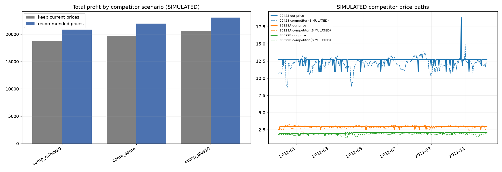

# Retail Pricing AI: Profit-Maximising Price Recommendations from Transactional Sales Data

**Project Report (revised after independent review)**  
**Date:** 14 November 2026  
**Repository:** https://github.com/harshithsakhamuri/RetailPricingAI  
**Live application:** https://harshithsakhamuri.github.io/RetailPricingAI/

---

## Abstract

This project builds an end-to-end decision system that recommends profit-maximising retail prices from the UCI
Online Retail dataset (541,909 transaction lines, December 2010 to December 2011). It has three stages:
(1) a 7-day-ahead forecast of baseline demand for the top 500 products, chosen among machine-learning models and
naive baselines; (2) own-price elasticities from a Poisson (PPML) panel with item and date fixed effects,
partially pooled by category and checked with a placebo test and an out-of-sample backtest; and (3) a robust
optimiser that maximises the 25th-percentile profit over 500 elasticity draws within business limits.

This revision follows an independent review and reports the results more conservatively. Most recommended
prices are set by a business limit rather than by the data, because the estimated price sensitivity (median −0.82)
implies implausibly high optimal prices. A backtest on later real price changes suggests customers are more
price-sensitive than estimated (implied median −2.13, from only 10 events). Across all 500 products the
cross-fitted expected gain from high- and medium-confidence recommendations is £5,892 for the decision week. Only
17 products reach high confidence. The system's main value is therefore a transparent decision framework and a
price-testing plan, not the headline profit figure.

---

## 1. Introduction

### 1.1 Problem statement
For each product, recommend the price for the coming week that maximises

> **profit = (price − unit cost) × expected units sold**

within realistic business rules, and state honestly how far the data supports the recommendation.

### 1.2 Objectives
1. Forecast baseline weekly demand at the current price.
2. Estimate how demand responds to price from real data, and test those estimates.
3. Choose the profit-maximising price under uncertainty and business limits.
4. Report confidence, what set each price, and how to test it.
5. Deliver results through a no-install web interface, with batch and portfolio views.

---

## 2. Data

### 2.1 Source
**UCI Online Retail** (CC BY 4.0): all transactions of a UK online gift wholesaler, 1 December 2010 to
9 December 2011. The raw file (22 MB) is not stored in the repository (see `data/README.md`).

### 2.2 Cleaning
- **Cancellations are netted** against the same customer's earlier orders of the same item, most recent first.
  This removed 250,838 units, and 2,863 order lines were fully cancelled. A further 23,970 cancelled units had no
  earlier order in the data and were ignored.
- **Lines without a CustomerID are excluded** by default (25% of lines, 15% of revenue, mostly guest or retail
  buyers). Recommendations therefore describe registered, mainly wholesale, customers. This is a setting
  (`INCLUDE_GUEST_LINES`).
- Non-product codes (postage, fees, adjustments) and price typos (more than 5× or less than 0.2× the item's
  median) are removed. 393,090 lines remain.
- **One price definition throughout:** the *list price*, the median unit price of regular-size lines (quantity no
  larger than the item's median line). Bulk lines carry tier discounts and would otherwise create artificial price cuts.

### 2.3 Categories and variants
Products are grouped into nine categories by **whole-word** keyword rules on the description, so "TIN" no longer
matches "BUNTING". Colour and design variants (for example the Regency teacups in rose, green and pink) are
identified by removing colour and design words from the name.

### 2.4 Data splits (strictly by date)

| Split | Period | Use |
|---|---|---|
| Train | to 2011-08-31 | fit models |
| Calibration | 2011-09-01 to 2011-09-30 | early stopping, level calibration |
| Selection | 2011-10-01 to 2011-10-31 | choose the forecast model |
| Test | 2011-11-01 to 2011-12-09 | report accuracy; production calibration |
| Decision horizon | 2011-12-10 to 2011-12-16 | recommendations |

The splits are defined relative to the last data day. `--as-of` re-runs the whole system for any earlier week.

---

## 3. Methodology

### 3.1 Baseline demand forecast
- **Candidates:** LightGBM, XGBoost and Random Forest (Tweedie loss), their ensemble, and two naive baselines
  (same day last week; 28-day mean rate).
- **Features:** calendar features and demand lags or rolling windows at least 7 days old; an automated test
  confirms that no feature uses later data. No price features are used, so price effects come only from stage 2.
- **Fair selection:** every candidate, including the naive ones, gets a level-calibration factor fitted on the
  calibration month, and the winner is chosen on the selection month.
- **Production calibration:** the chosen model is refitted on data up to 2011-10-31, and its level error on the
  test weeks (factor 1.20) is applied to the final full-history refit. The factor therefore belongs to the refit
  model rather than the train-only model.

### 3.2 Own-price elasticity
- **Model:** for each category, a Poisson pseudo-maximum-likelihood regression of daily units on log list price
  with item and date fixed effects, on **every trading day**. Zero-sale days are included, and on days without a
  sale the last list price applies.
- **Item slopes:** each item's slope uses the category's date effects, with Newey-West standard errors. An item
  qualifies only with at least 8 weeks of sales and at least 2 weekly list prices, each held for at least 3 **weeks**.
- **Pooling:** empirical Bayes, global → category → item. A category slope is trusted only if at least 10 of its
  items changed price; otherwise the global prior is used. Items whose own slope shows demand *not* falling with
  price (32 items) contribute no evidence: they take the category value and are flagged low confidence. No pooled
  elasticity can be positive.
- **Placebo test:** each item's price path is shifted in time 20 times and the category slope re-estimated. Real
  slopes far from the placebo distribution indicate a genuine price effect rather than an artefact.
- **Out-of-sample backtest:** elasticities re-estimated on data up to 2011-08-31 predict the demand change after
  later real list-price changes, measured against the rest of the item's category.

### 3.3 Competitor effect (simulated)
A seeded synthetic competitor price is generated. Because the real-data elasticity already contains any competitor
reaction, the competitor enters **only** as a demand shift when its price level differs from the reference
(demand × level^0.5). It does not add to the own-price slope.

### 3.4 Unit costs (assumed)
60% of each item's median list price, adjustable by category or product.

### 3.5 Robust price decision
For each product, candidate prices with realistic endings are evaluated over 500 elasticity draws. The chosen price
maximises the **25th-percentile profit**, within these limits:

- at most ±20% from the current price;
- at most 10% above the highest weekly list price ever charged (flagged as untested);
- a minimum margin of 20%;
- an optional stock cap.

Each recommendation also reports:
- **What set the price:** the data (an interior optimum or keeping the price), a named limit, or joint pricing with variants.
- **Lerner check:** the unconstrained optimal price implied by the elasticity, as a plausibility test.
- **Cross-fitted gain:** the price is chosen on half the draws and its gain scored on the other half.
- **Joint pricing:** variants that currently share a price keep one common price.
- **P10–P90 profit range:** includes both elasticity uncertainty and baseline-forecast error (empirical
  actual/forecast ratios from the test weeks, by volume band).

### 3.6 Confidence
| Rating | Rule |
|---|---|
| High | profit at risk vs the current price ≤ 2%, the change beats the current price in ≥ 80% of draws, the price has been charged before, **and the item has its own price-change evidence** |
| Medium | profit at risk ≤ 5% and the change wins in ≥ 60% of draws |
| Low | otherwise, or very low volume, an infeasible price range, or contradictory own data |

### 3.7 Price-test planner
For every item below high confidence, the system designs a switchback test (alternate weeks at the current and test
price) and computes the trading days needed to distinguish elasticity −1 from −2 at 5% significance and 80% power.
It also estimates the duration when the same percentage change is tested across the item's category.

---

## 4. Results

### 4.1 Forecast accuracy (7-day product totals, WAPE %)

| Model | Calibration | Selection month | Test | Test bias % |
|---|---|---|---|---|
| **LightGBM (selected)** | 1.31 | **63.0** | 53.5 | −0.5 |
| XGBoost | 1.24 | 63.6 | 52.5 | −2.1 |
| Random Forest | 1.16 | 67.2 | 59.3 | 0.8 |
| Ensemble | 1.24 | 64.1 | 54.6 | −0.6 |
| Naive: same day last week | 1.12 | 75.4 | 66.5 | 7.9 |
| Naive: 28-day mean rate | 1.11 | 65.8 | 52.9 | −1.4 |

LightGBM wins the selection month fairly, but on the test weeks it is slightly worse than XGBoost and the calibrated
28-day average. **Machine learning adds no reliable accuracy over a calibrated simple average for this data.** The
baseline scales profit equally at every price, so this affects the £ figures but not which price is chosen.

### 4.2 Elasticity

| Category | Category slope | Items with price changes | Prior used |
|---|---|---|---|
| Bags | −1.21 | 18 | category slope, pooled to −0.84 |
| Kitchen & baking | −0.87 | 19 | category slope, pooled to −0.83 |
| Home décor | −0.82 | 27 | category slope, −0.82 |
| Other | −0.52 | 22 | category slope, pooled to −0.79 |
| Lighting, stationery, storage, Christmas, toys | — | 0–4 each | global prior −0.82 |

- 63 items have usable price changes of their own, 405 never changed price, and 32 have contradictory data.
- **Placebo test:** the real slopes for bags (z = −3.5), kitchen & baking (−4.9) and home décor (−2.3) lie well
  outside their placebo distributions, so these are genuine price effects. "Other" (z = −1.6) is not clearly
  distinguishable from noise.
- **Backtest:** on 10 later real price changes, the model's predicted demand change has mean absolute error 1.09,
  against 1.41 for assuming price has no effect (correlation 0.73, direction correct in 60%). The demand changes
  imply a median elasticity of **−2.13**, much stronger than the model's −0.82. With only 10 events this is
  indicative, but it points the same way as the Lerner check below.

### 4.3 Recommendations

| Metric | Value |
|---|---|
| Prices set by a business limit | 372 of 500 (upper limits 371, lower limit 1) |
| Jointly priced variants | 82 items |
| Prices set by the data | 19 (10 interior optimum, 9 keep current price) |
| Items whose elasticity implies an optimal price > 1.5× current (Lerner check) | 98% |
| Confidence (all 500): high / medium / low | 17 / 421 / 62 |
| Confidence (top 50): high / medium / low | 0 / 46 / 4 |
| Cross-fitted weekly gain, all 500, high + medium | **£5,892** (low confidence: £628) |
| Cross-fitted weekly gain, top 50, high + medium | £2,160 on a baseline of £19,684 |

The Lerner check shows that with elasticity around −0.82 and 40% margins, the unconstrained optimum would be far
above current prices. That is implausible for a business that has priced this way for a year, so the elasticities
are very likely biased toward zero by non-experimental price variation, as the backtest also suggests. Recommended
increases at the upper limit should therefore be treated as hypotheses to test, not as instructions. The
cross-fitted gain turned out equal to the in-sample gain because the chosen price is stable across draw subsets;
the larger source of optimism is the elasticity bias, not draw-selection noise.

Largest expected gains among the top 50 products by revenue:

| Code | Product | Current £ | Recommended £ | Gain £ | Evidence | Price set by |
|---|---|---|---|---|---|---|
| 23084 | Rabbit Night Light | 2.08 | 2.49 | 361 | category only | +20% cap |
| 22423 | Regency Cakestand 3 Tier | 12.75 | 14.00 | 126 | category only | highest price charged |
| 85099B | Jumbo Bag Red Retrospot | 2.08 | 2.25 | 101 | own + category | joint with variants |
| 84879 | Assorted Colour Bird Ornament | 1.69 | 1.85 | 98 | category only | highest price charged |
| 22086 | Paper Chain Kit 50's Christmas | 2.95 | 3.10 | 90 | category only | highest price charged |
| 23284 | Doormat Keep Calm and Come In | 8.25 | 9.05 | 86 | own + category | highest price charged |

### 4.4 Price-test plan
Only 10 of 483 items below high confidence could be tested individually within 12 weeks, because single-item
daily sales are very noisy. Testing the same percentage change across an item's category makes 229 of them
practical. The plan is in `outputs/price_test_plan.csv` and on each item's page.

### 4.5 Competitor scenarios (simulated)

| Scenario | Profit at current prices £ | Profit at recommended prices £ |
|---|---|---|
| Competitor −10% | 18,673 | 20,836 |
| Competitor unchanged | 19,684 | 21,964 |
| Competitor +10% | 20,644 | 23,036 |

---

## 5. Deployment and engineering

| Component | Description |
|---|---|
| Web app (`docs/`) | Runs in the browser with no server. Existing-item, new-item, batch CSV and all-recommendations views; CSV downloads. |
| `src/pricing_core.py` + `docs/pricing.js` | One decision engine with an exact JS port; a test checks they agree on 41 cases. |
| Streamlit app (`app/`) | Optional local app; reads portable Parquet/JSON artifacts and keeps no shared state between users. |
| Tests and CI | 54 tests on every push: decision rules, each review finding, feature leakage, recovery of a known elasticity, JS parity, the Streamlit app, and invariants on the committed outputs. A manual CI run re-trains from the public dataset. |
| Reproducibility | Pinned dependency versions; `.sh` and `.bat` scripts; `--as-of` for other decision weeks. |

---

## 6. Limitations

1. **Price endogeneity remains.** The placebo test and backtest bound the problem but cannot remove it; the
   evidence suggests estimated sensitivity is too weak, so increases are overstated.
2. **Little price variation:** 405 of 500 items never changed price and rely on a category or global prior.
3. **Assumed costs and simulated competitor.** Absolute £ figures are illustrative.
4. **Forecast:** machine learning does not beat a calibrated simple average on the test weeks.
5. **Constant elasticity**, applied only within ±20% of current prices.
6. **Unusual horizon:** the default week is the pre-Christmas peak. In an `--as-of 2011-09-30` run, the backtest
   found the elasticities no better than assuming no price effect, so results vary by period.
7. **Small backtest:** 10 events for the default run.

---

## 7. Recommended next steps

1. Run the category-level price tests in `price_test_plan.csv`, starting with the categories that have the largest
   recommended changes, and feed the results back as elasticity evidence.
2. Replace the assumed costs with real landed costs, and the simulated competitor with real competitor prices.
3. Consider replacing the ML forecast with the calibrated 28-day average unless new data shows a consistent ML gain.
4. Re-run with `--as-of` across several weeks to see how stable the recommendations are.

---

## 8. Conclusion

The project delivers a complete, tested and reproducible pipeline from raw transactions to price recommendations,
served through a zero-install web application with batch and portfolio views. After the review its outputs are
deliberately conservative. Every recommendation states what set the price, how strong its evidence is, and how to
test it, and the headline gain counts only high- and medium-confidence items. The data supports modest price
increases on many items, but it cannot pin down by how much: the placebo test confirms real price effects in
three categories, while the backtest and Lerner check show the estimated sensitivity is probably too weak.
Controlled price tests, which the system now plans, are the necessary next step before acting at scale.

---

## References

1. Chen, D. (2015). *Online Retail* [Dataset]. UCI Machine Learning Repository. https://doi.org/10.24432/C5BW33
2. Santos Silva, J. M. C., & Tenreyro, S. (2006). The log of gravity. *Review of Economics and Statistics*, 88(4), 641–658.
3. Chen, T., & Guestrin, C. (2016). XGBoost: A scalable tree boosting system. *Proceedings of KDD 2016*.
4. Ke, G., et al. (2017). LightGBM: A highly efficient gradient boosting decision tree. *NeurIPS 2017*.
5. Newey, W. K., & West, K. D. (1987). A simple, positive semi-definite, heteroskedasticity and autocorrelation
   consistent covariance matrix. *Econometrica*, 55(3), 703–708.
6. DerSimonian, R., & Laird, N. (1986). Meta-analysis in clinical trials. *Controlled Clinical Trials*, 7(3), 177–188.
7. Smith, J. E., & Winkler, R. L. (2006). The optimizer's curse. *Management Science*, 52(3), 311–322.
